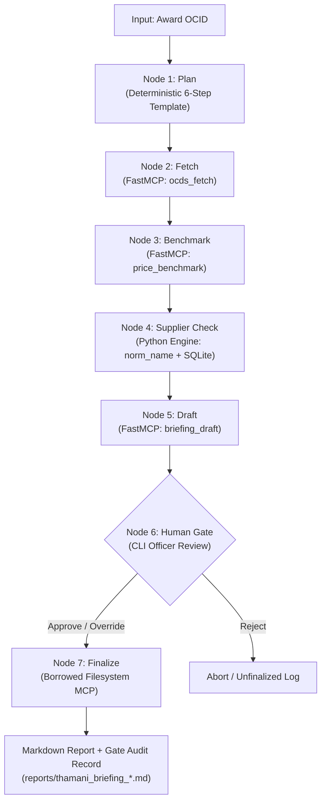

# Thamani - System Architecture

Thamani is an agentic AI value-for-money analysis engine for Kenyan public procurement. It provides automated anomaly detection, supplier history tracing, and benchmark comparisons while enforcing strict human oversight.

---

## Core Components

### 1. Data Layer (`src/thamani_server/ocds.py`)
- **Source**: Open Contracting Data Standard (OCDS) releases published by Kenya Public Procurement Regulatory Authority (PPRA) via Open Contracting Partnership (OCP) Registry (Publication 147).
- **Storage**: Embedded SQLite database (`data/thamani.sqlite`) with WAL mode and compound indexes.
- **Normalization**: `norm_name()` strips corporate suffixes (`LTD`, `LIMITED`, `CO`, `PLC`) and punctuation to ensure alias variants (e.g. `AFRICAN TOUCH SAFARIS` vs `AFRICAN TOUCH SAFARIS LIMITED`) resolve to a single legal entity identity.
- **Scale**: 260,744 tenders, 113,246 awards spanning 2018–2026.

### 2. FastMCP Tool Server (`src/thamani_server/server.py`)
Provides three analysis tools accessible via the Model Context Protocol:
- `ocds_fetch(ocid: str)`: Looks up tender metadata and award details from SQLite, outputting source OCIDs for structural provenance.
- `price_benchmark(category: str, value_amount: float, currency: str)`: Computes empirical category distribution (P25, Median, P75, P99), flags statistical outliers, detects absurd values (>1000× median) and non-KES currency anomalies, and returns the 5 nearest benchmark OCIDs.
- `briefing_draft(findings: list[dict], ...)`: Assembles Markdown briefing. Structurally rejects any draft where findings lack source OCID citations or contain forbidden recommendation language.

### 3. Borrowed MCP Server Integration (`filesystem`)
- **Tool**: Standard Filesystem MCP server protocol adapter (`FilesystemMCPClient`).
- **Justification**: Rebuilding file I/O adds zero novel engineering value; Thamani's innovation focuses on value-for-money governance and procurement integrity analysis.
- **Enforcement**: Only invoked in the `finalize` node after explicit human gate clearance.

### 4. Agent Orchestrator (`src/agent/loop.py`)
- **Framework**: LangGraph (open-source DAG orchestrator).
- **State Machine**: Strongly typed `ThamaniState` holding records, benchmarks, findings, and immutable run logs.
- **Human-in-the-Loop Gate**: CLI interface halting execution until the named procurement officer enters `approve`, `override <finding-id> <note>`, or `reject`.
- **Audit Logging**: Every state transition appends execution telemetry to `runs/<utc-timestamp>.jsonl`.
- **Model Review Focus**: When `--model` is supplied, NVIDIA Nemotron selects a review area and an existing finding ID. The selection is validated against computed findings before the original finding and its OCID sources appear in the draft. Model calls are recorded in the run log.
